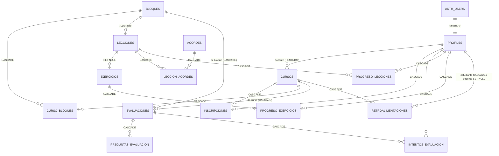

# Modelo de datos objetivo (Fase 3)

> Referencia para HU-B-301 … HU-B-312. Las reglas de borrado están en
> [`05-contrato-base-datos.md`](../fase-1-contrato/05-contrato-base-datos.md#4-política-de-borrado-on-delete).

## Diagrama entidad-relación

## Tablas

### Existentes que cambian

| Tabla | Cambio | HU |
|---|---|---|
| `profiles` | + `rol text not null default 'estudiante' check (rol in ('estudiante','docente','admin'))`, + `actualizado_en` | HU-B-304 |
| `bloques` | + `estado`, `actualizado_en`; `unique(orden_index)` | HU-B-306 |
| `lecciones` | `bloque_id` FK **CASCADE** e índice; + `autor_id` (SET NULL), `estado`, `archivado_en`, `actualizado_en`; `duracion` text → `duracion_min int` | HU-B-306 |
| `ejercicios` | + `autor_id`, `estado`, `archivado_en`, `actualizado_en`; `duracion` → `duracion_min` | HU-B-306 |
| `acordes` | sin cambios estructurales (`diagram jsonb` se respeta) | — |
| `quiz_preguntas` | se migra a `preguntas_evaluacion` y se elimina | HU-B-308 |
| `progreso` (polimórfica) | se divide en `progreso_lecciones`, `progreso_ejercicios`; el progreso de bloque pasa a `intentos_evaluacion` | HU-B-305 |
| `partituras` | sin uso; se conserva (decisión de producto pendiente) | — |

### Nuevas

| Tabla | Columnas clave | Restricciones |
|---|---|---|
| `cursos` | `id serial`, `nombre`, `descripcion`, `docente_id uuid`, `nivel`, `codigo_invitacion char(8)`, `archivado_en`, `creado_en`, `actualizado_en` | `unique(codigo_invitacion)`; FK docente **RESTRICT** |
| `inscripciones` | `id uuid`, `curso_id`, `estudiante_id`, `inscrito_en` | `unique(curso_id, estudiante_id)` |
| `curso_bloques` | `curso_id`, `bloque_id`, `orden` | PK compuesta; `unique(curso_id, orden)` |
| `leccion_acordes` | `leccion_id`, `acorde_id` | PK compuesta (reemplaza a futuro `lecciones.acordes text[]`, opcional) |
| `evaluaciones` | `id serial`, `titulo`, `descripcion`, `bloque_id null`, `curso_id null`, `autor_id`, `porcentaje_aprobacion int default 80`, `intentos_max int null`, `fecha_limite timestamptz null`, `estado` | `check (num_nonnulls(bloque_id, curso_id) >= 1)`; `estado in ('borrador','publicada','cerrada')` |
| `preguntas_evaluacion` | `id serial`, `evaluacion_id`, `enunciado`, `opciones jsonb`, `respuesta_correcta int`, `orden` | `check (jsonb_typeof(opciones)='array')`; `unique(evaluacion_id, orden)` |
| `intentos_evaluacion` | `id uuid`, `evaluacion_id`, `estudiante_id`, `puntaje int`, `correctas`, `total`, `aprobado bool`, `respuestas jsonb`, `creado_en` | índice `(evaluacion_id, estudiante_id)` |
| `progreso_lecciones` | `estudiante_id`, `leccion_id`, `porcentaje`, `completado`, `actualizado_en` | PK `(estudiante_id, leccion_id)`; `check porcentaje between 0 and 100` |
| `progreso_ejercicios` | `estudiante_id`, `ejercicio_id`, `porcentaje`, `completado`, `mejor_bpm int null`, `actualizado_en` | PK `(estudiante_id, ejercicio_id)` |
| `retroalimentaciones` | `id uuid`, `curso_id`, `estudiante_id`, `docente_id null`, `mensaje text`, `leida_en`, `creado_en` | `check (length(mensaje) between 1 and 1000)` |

## Reglas de negocio que dependen del modelo

1. **Desbloqueo de bloques**: un bloque está disponible si es el primero de la ruta (global o del curso) o si el estudiante tiene un intento **aprobado** en la evaluación del bloque anterior.
2. **Mejor puntaje**: ya no se sobrescribe; se calcula con `max(puntaje)` sobre `intentos_evaluacion`. El historial completo queda disponible para el docente.
3. **Visibilidad docente**: un docente solo ve estudiantes con `inscripciones` en cursos donde `cursos.docente_id = él`.
4. **Contenido de un docente**: lo crea en `borrador`; solo lo ven sus estudiantes cuando está `publicado` y asociado a un bloque de alguno de sus cursos.
5. **Edición de evaluaciones**: las preguntas solo se pueden reemplazar si no hay intentos; si los hay, se debe crear una nueva evaluación (consistencia histórica).

## Columnas de auditoría

Todas las tablas nuevas o modificadas: `creado_en timestamptz not null default now()`
y, cuando son editables, `actualizado_en` mantenido por el trigger genérico
`public.tocar_actualizado_en()` (creado en HU-B-304 con `op.execute`).
